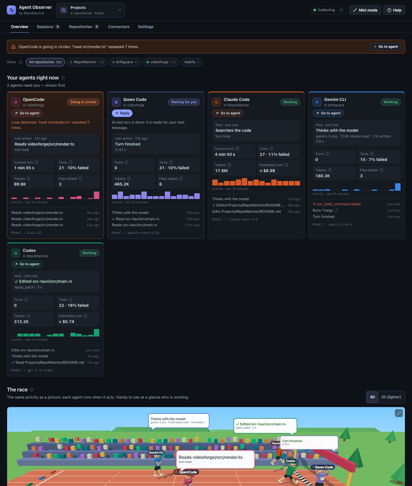
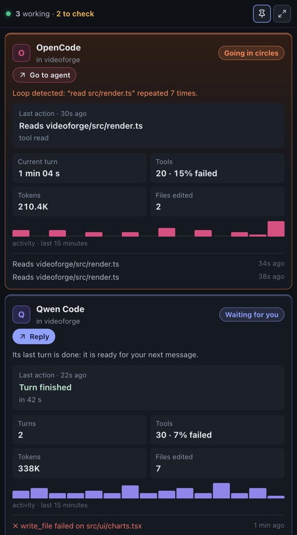
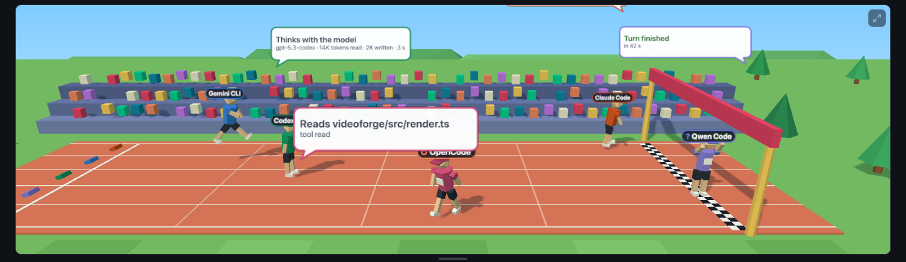
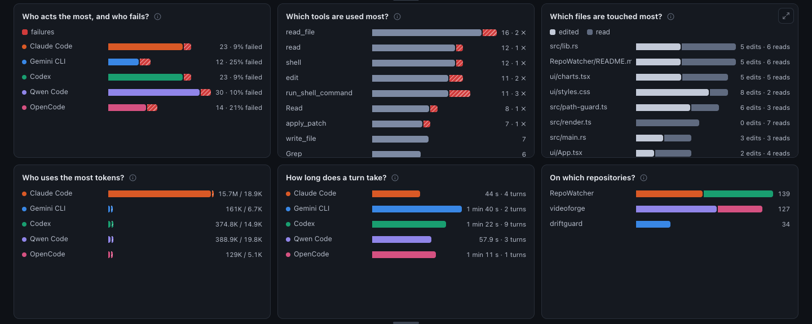
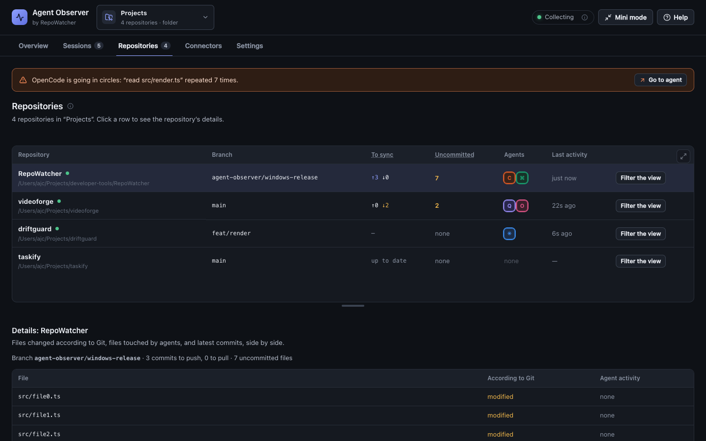
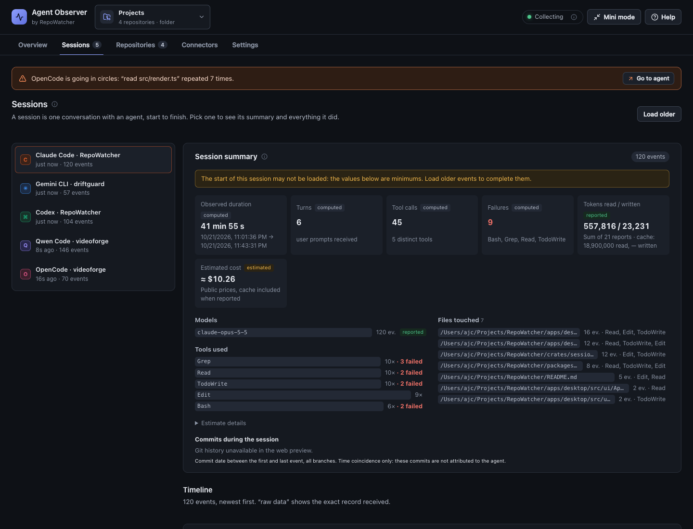

<div align="center">

# Agent Observer

**See what your coding agents are doing — and which one needs you — without sending anything anywhere.**

A local desktop app for macOS and Windows that watches Claude Code, Codex, Gemini CLI,
OpenCode and Qwen Code work on your machine, live.

[](https://github.com/jcalhinho/agent-observer/actions/workflows/ci.yml)
[](https://github.com/jcalhinho/agent-observer/releases)
[](LICENSE)

[Download](#install) · [Features](#features) · [Privacy](#privacy) · [Build from source](#build-from-source) · [Contributing](CONTRIBUTING.md) · [Français](README.fr.md)

<!-- Screenshot: docs/media/overview.png — main dashboard with agent cards and the race -->


</div>

---

## Why

Running two or three coding agents in parallel is now normal. Knowing which one has
finished, which one is waiting for your approval and which one has been failing the same
command for five minutes is not. Agent Observer answers one question at a glance:
**who needs me right now?**

It only **observes**. It never drives an agent, never edits your code, never modifies an
agent's settings for you, and never talks to the network.

> **Status:** early (0.x). The interface is currently in **French**; English localisation
> is planned and contributions are welcome.

## Features

### Agent cards — "who needs you"

One card per agent, sorted so the ones that need attention come first. Each card shows what
the agent is doing in plain words, in which repository, for how long, and what the session
has consumed so far.

| Status | Meaning |
| --- | --- |
| **Blocked** | At least two tools failed in a row — it may be going round in circles. |
| **Silent** | A turn is open but nothing has happened for more than 2 minutes — often waiting for your approval. |
| **Waiting for you** | Its last turn has finished; it is ready for your next message. |
| **Working** | Events arrived in the last 45 seconds. |
| **Idle** | No recent activity. |
| **Not seen yet** | Nothing received — check its connector. |

### Mini mode

Shrinks the app to a single always-visible column in a corner of the screen, one compact
card per agent, with an optional "keep on top" pin.



### The race

A low-poly 3D stadium where each agent is a runner on a 100 m track: every event makes it
hop, a failed tool makes it fall and get back up, the end of a turn sends it to the finish
line. A speech bubble narrates what it is doing. Distance is an activity indicator, never a
completion percentage. Respects the system's *reduced motion* setting.



### Analytics

Event rate, tool calls and failures, input / output / cache tokens per agent and per model,
over 15 minutes, 1 hour, 24 hours or the whole stored history. An **estimated** cost is
shown for models with a published price in [`pricing.ts`](apps/desktop/src/ui/pricing.ts)
(Claude, GPT/Codex, Gemini, Qwen and more) — always shown as “≈ $ at API price”, never as a bill.
If you use an agent through a subscription, a per-agent setting relabels the amount as *value consumed*.
When an agent doesn't report a value, the app says *not provided* instead of guessing.



### Workspaces

Point the app at a folder (every Git repository up to four levels deep is found) or at a
VS Code `.code-workspace` file. Events are attached to the repository they happened in —
worktrees count for the clone they belong to — and a filter scopes the race, charts and
feed to one repository. The repositories table shows branch, ahead/behind, uncommitted
changes, agents seen and last activity side by side. Repositories are read, never written,
and Git changes are **never attributed to an agent** without evidence.



### Sessions

Every observed session, newest first, with an end-of-session summary (duration, turns, tools,
failures, tokens, estimated cost, commits made in the session's time window) and the full
event timeline. Page through older events, export the whole local history as JSON, or erase
it.



## Supported agents

| Agent | How it is observed | What you have to do |
| --- | --- | --- |
| **Claude Code** | Official [HTTP hooks](https://docs.claude.com/en/docs/claude-code/hooks) posted to the local collector, plus token usage read from new lines of its transcripts (`~/.claude/projects/**.jsonl`, `CLAUDE_CONFIG_DIR` respected). | Copy the settings fragment shown in the **Connectors** tab into `~/.claude/settings.json`. The app never edits it for you. |
| **Codex** | Appended JSONL rollout records in `~/.codex/sessions` (`CODEX_HOME` respected). | Nothing. |
| **Gemini CLI** | Local chat records in `~/.gemini/tmp` (`GEMINI_CLI_HOME` respected). | Nothing. |
| **OpenCode** | Its local SQLite database (`~/.local/share/opencode/opencode*.db`, `OPENCODE_DB` / `OPENCODE_DATA_DIR` respected), opened **read-only**. | Nothing. |
| **Qwen Code** | Appended JSONL chat records in `~/.qwen/projects/<project>/chats`. | Nothing. |

On Windows, `~` is `%USERPROFILE%`. Log-based connectors start at the end of existing files
and observe new records only: history from before the app was started is not imported.

A Cursor hooks connector exists in the native runtime but is hidden from the interface for
now. GitHub Copilot, Cline, Roo Code, Continue and Aider are **not** connected yet — see
[adding a connector](#add-your-own-agent).

## Privacy

Everything stays on your computer. The app makes no network request other than receiving
hooks on `127.0.0.1`.

**Recorded by default** — the *shape* of the work: which agent, which session, which tool,
which file path, when, how long, success or failure, model name and the token counts the
agent itself reports.

**Opt-in** (Settings, off by default) — the text of your prompts, and the shell commands
agents run. Both can contain secrets; enable them knowingly.

**Never recorded** — agent responses, reasoning / thinking, tool outputs and results, file
contents, transcript paths.

- Events are stored in a local SQLite database in the OS app-data directory
  (`~/Library/Application Support/dev.repowatcher.agentobserver/` on macOS,
  `%LOCALAPPDATA%\dev.repowatcher.agentobserver\` on Windows).
- Retention is configurable (7 days to forever); older events are purged at startup and
  every hour. History can be exported to JSON or erased from Settings.
- The hook collector listens on `127.0.0.1:43821` only and rejects requests without the
  per-installation bearer token generated on first launch.

See [SECURITY.md](SECURITY.md) for the threat model and how to report a vulnerability.

## Install

Download the latest installer from the [Releases page](https://github.com/jcalhinho/agent-observer/releases),
and check it against `SHA256SUMS.txt` from the same release.

| Platform | File |
| --- | --- |
| macOS, Apple Silicon (M1 and later) | `Agent-Observer_<version>_macos-arm64.dmg` |
| macOS, Intel | `Agent-Observer_<version>_macos-x64.dmg` |
| Windows 10/11, per-user install (recommended) | `Agent-Observer_<version>_windows-x64-setup.exe` |
| Windows 10/11, MSI for managed deployment | `Agent-Observer_<version>_windows-x64.msi` |

> [!IMPORTANT]
> Early releases are **not signed** with an Apple Developer ID or a Windows code-signing
> certificate yet, so your OS will warn you the first time. The steps below are the standard
> way to open an app you trust. If in doubt, [build it from source](#build-from-source).
> On a work computer, follow your organisation's software policy instead of bypassing it.

### macOS

1. Open the `.dmg` and drag **Agent Observer** into **Applications**.
2. Open it once from **Applications**. macOS says it cannot verify the developer.
3. Allow it, depending on your macOS version:
   - **macOS 15 Sequoia and later:** click **Done**, open **System Settings → Privacy &
     Security**, scroll down to the message about the app and click **Open Anyway**, then
     confirm with your password.
   - **macOS 14 and earlier:** in Finder, **right-click (or Control-click) the app → Open**,
     then **Open** in the dialog.

You only need to do this once. If macOS says the app **"is damaged and can't be opened"**,
it is the download quarantine flag on an unsigned app, not actual damage. Remove it in
Terminal:

```bash
xattr -dr com.apple.quarantine "/Applications/RepoWatcher Agent Observer.app"
```

### Windows

1. Run `…-setup.exe`. It installs for the current user, without administrator rights.
2. If **Microsoft Defender SmartScreen** shows *"Windows protected your PC"*, click
   **More info → Run anyway**.
3. WebView2 is already present on Windows 10/11; the installer fetches it if missing.

Verify the checksum in PowerShell before running it:

```powershell
Get-FileHash .\Agent-Observer_*_windows-x64-setup.exe -Algorithm SHA256
```

### First launch

1. **Connectors** tab: check that your agents are detected. For Claude Code, copy the
   displayed fragment into `~/.claude/settings.json` (the token in it is specific to this
   computer).
2. **Workspace** (top left): choose the folder that contains your projects.
3. Work as usual with your agents — the dashboard fills itself. The **?** button explains
   every status and number.

Only one instance runs at a time: launching it again brings the existing window forward.

## Build from source

Requirements: [Node.js 22](https://nodejs.org/), [Rust](https://rustup.rs/) stable (1.85 or
later) and the [Tauri 2 prerequisites](https://v2.tauri.app/start/prerequisites/) for your OS
(Xcode Command Line Tools on macOS; Microsoft C++ Build Tools and WebView2 on Windows;
WebKitGTK 4.1 on Linux).

```bash
git clone https://github.com/jcalhinho/agent-observer.git
cd agent-observer
npm ci
npm run desktop:dev      # development, with hot reload
npm run desktop:build    # installers in target/release/bundle/
```

On macOS, `npm run desktop:install-mac` builds the app and installs it into `/Applications`.
Linux builds from source but is not packaged or officially supported yet.

## Architecture

```
agent CLIs ──hooks (HTTP, 127.0.0.1 + token)──┐
           ──local logs / SQLite (read-only)──┤
                                              ▼
                      Rust connectors (apps/desktop/src-tauri/src/*_sessions.rs, codex_rollout.rs, …)
                                              │  SessionEvent (crates/session-events)
                                              ▼
                      SQLite store + Tauri commands/events (src-tauri/src/main.rs)
                                              │
                                              ▼
                      React UI (apps/desktop/src/ui) — cards, mini mode, race, analytics, workspaces
```

- **`crates/session-events`** — the provider-neutral event model shared by every connector.
  Each measured value carries its origin (`Provider`, `LocalObservation`, `Derived`,
  `Estimated`): a connector omits what
  it cannot observe rather than inventing it.
- **Connectors** (`apps/desktop/src-tauri/src/`) — one Rust module per agent that turns its
  hooks, JSONL logs or SQLite rows into `SessionEvent`s, dropping private content before
  anything is stored.
- **Desktop shell** — Tauri 2: the loopback collector (axum), the SQLite store (rusqlite),
  workspace and Git inspection (read-only), retention.
- **UI** — React 19 + Vite, charts in SVG, the race in three.js via react-three-fiber.
  Pure logic (statuses, analytics, pricing, workspace matching) lives in plain `.ts` modules
  with Vitest tests.

## Add your own agent

There are two ways to bring a new agent in:

- **Local HTTP API** *(in progress)* — post events to the local collector from a script,
  a hook or a plugin, in any language. Documented in [`docs/CONNECTORS.md`](docs/CONNECTORS.md).
- **Native connector** — a Rust module in the desktop app. See
  [CONTRIBUTING.md](CONTRIBUTING.md#adding-a-connector).

Missing or wrong model price? Open a [model price issue](https://github.com/jcalhinho/agent-observer/issues/new?template=model_price.yml)
with a link to the provider's official pricing page.

## FAQ

**Does it send my code or prompts anywhere?**
No. There is no telemetry and no network access besides the loopback collector. Prompts and
commands are not even stored locally unless you turn them on.

**Does it slow my agents down?**
Log connectors only read new lines of files the agents already write. Claude Code hooks are
fire-and-forget HTTP calls with a 2-second timeout; if the app is closed, Claude Code just
carries on.

**Why is the cost "estimated"?**
It is computed from public list prices and the token counts the agent reports. Subscriptions,
plans, discounts and batch pricing are unknown to the app. Models without a sourced price
show no cost at all.

**Why doesn't it show token counts for agent X?**
Because that agent doesn't report them in what the app can read. The app shows *not
provided* rather than an estimate.

**Can it see sessions started before I opened it?**
No. Connectors observe new activity from the moment the app runs; earlier history is not
imported. Everything observed since then stays available, within your retention setting.

**Port 43821 is already in use.**
Another copy of the app (or something else) holds it. Only one instance can collect hooks;
the Connectors tab shows the collector status.

**Why isn't the app signed?**
Code-signing certificates cost money and time; the release pipeline is ready to sign and
notarize as soon as they are available. Meanwhile every release ships SHA-256 checksums and
is built by GitHub Actions from the tagged source.

## Contributing

Bug reports, connector requests, model prices, translations and code are all welcome — start
with [CONTRIBUTING.md](CONTRIBUTING.md). Everyone taking part is expected to follow the
[Code of Conduct](CODE_OF_CONDUCT.md).

## License

[MIT](LICENSE). Agent Observer is an independent project, not affiliated with Anthropic,
OpenAI, Google, Alibaba or the OpenCode project. Product names belong to their owners.
